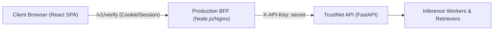

# TrustNet Web Dashboard (Stage 11)

The TrustNet Web Dashboard is a responsive, accessible frontend for multimodal claim verification, automated evidence retrieval, and epistemic reasoning. Built with **React 19, Vite, TypeScript, and TailwindCSS**.

---

## 🚀 Quick Start

### 1. Install Dependencies
```bash
npm install
```

### 2. Configure Environment (Dev Server Proxy)
Ensure your local backend API (from Stage 10) is running on `http://127.0.0.1:8000`:
```bash
# In the repository root
python -m uvicorn trustnet.api.app:app --host 0.0.0.0 --port 8000
```

Set the backend API key in your server environment:
```bash
# Windows PowerShell
$env:TRUSTNET_API_KEY="dev-test-key-stage10"

# Linux / macOS
export TRUSTNET_API_KEY="dev-test-key-stage10"
```

### 3. Run Dev Server
```bash
npm run dev
```
Open `http://localhost:5173` in your browser.

---

## 🛠 Available Scripts

| Command | Purpose |
| :--- | :--- |
| `npm run dev` | Starts Vite dev server with proxy at `http://localhost:5173`. |
| `npm run build` | Runs TypeScript compilation (`tsc -b`) and Vite production bundle. |
| `npm run lint` | Runs ESLint including custom AST rules banning `dangerouslySetInnerHTML`. |
| `npm run test` | Runs Vitest unit & integration test suites with MSW mock network. |
| `npm run test:watch` | Runs Vitest in interactive watch mode. |
| `npm run test:e2e` | Runs Playwright tests (Desktop & 360px Mobile) with Axe accessibility scans. |
| `npm run gen:types` | Regenerates TypeScript API schemas directly from `../docs/openapi.json`. |

---

## 🔒 BFF Security Model & Key Protection

### Zero Secret Leaks in Browser Bundles
The API key must **NEVER** appear in client-side code, HTML, or `VITE_*` environment variables.

In development, [`vite.config.ts`](./vite.config.ts) configures a server-side proxy for `/v1/*` requests. The proxy interceptor reads `process.env.TRUSTNET_API_KEY` directly from the Node.js process and attaches the `X-API-Key` header on outgoing HTTP requests to the FastAPI backend. The client browser only ever communicates with `/v1/*` on the same origin (`localhost:5173`) without credentials in the payload.

### Production BFF Architecture
In a production deployment, a lightweight Backend-for-Frontend (BFF) proxy (such as Next.js API Routes, Express/Fastify gateway, or Nginx/Cloudflare Worker) must sit between the user's browser and the TrustNet verification cluster:

- **BFF responsibilities**:
  1. Authenticates user session (cookie/JWT).
  2. Injects internal API credentials (`X-API-Key`) over an encrypted internal network.
  3. Enforces rate limits per IP/user before reaching heavy ML inference workers.
  4. Scrubs internal debug logs and ensures proper Content-Security-Policy headers.

---

## 🛡 Epistemic Integrity & Verdict Copy

TrustNet is an evidence-grounded verification assistant, not an arbiter of absolute truth. All user-facing copy strictly adheres to standardized epistemic definitions:

1. **Standardized Verdict Phrases**:
   - **Contradicted**: `"Reliable sources we searched disagree with this claim"`
   - **Insufficient**: `"We couldn't confirm this. Don't share it as confirmed"`
   - **Abstained**: `"We couldn't confirm this. Don't share it as confirmed"`
   - **Verified**: `"Supported by the sources we searched"`
2. **Strict Prohibition**: The words `"true"`, `"false"`, or `"fake"` are **strictly banned** as verdicts across all UI components and tests.
3. **Model Confidence vs. Truth**: Model confidence reflects certainty given retrieved documents, **NOT** the probability of absolute truth. The UI explicitly forbids placing green checkmarks next to percentage figures.
4. **Style Signals**: Rhetorical manipulation tags (emotional appeal, urgency, conspiratorial tone, sensationalism) are clearly segregated with a prominent warning:
   > *"Style signals are NOT evidence about truth; they only describe how the claim is written."*

---

## 🔐 Privacy & Data Minimization

- **No Browser Storage of Sensitive Content**: Claim text, uploaded images, and extracted text are **strictly never saved** to `localStorage`, `sessionStorage`, `IndexedDB`, or cookies.
- **Ephemeral Verification**: By default, reports can be stored ephemerally without persistent database retention when unchecking "Store result".
- **Opt-in Recent References**: If enabled, the browser stores only opaque UUID report references (`rep-xxxx`) and timestamps. A "Clear History" button purges these references immediately.
- **XSS Immunity**: Zero usage of `dangerouslySetInnerHTML` enforced across the entire codebase via ESLint AST rules.

---

## 🌐 Internationalization (i18n)

User copy is fully localized into English (`src/copy/en.ts`) and Hindi (`src/copy/hi.ts`). Both dictionaries maintain strict 1:1 key parity validated on every test run. The user can switch between English and Hindi at any time using the header toggle.

---

## ♿ Accessibility & Responsive Design

- **WCAG AA Compliance**: High-contrast color tokens for text, badges, and progress meters.
- **Keyboard Navigation**: Skip-to-content links (`#main-content`), distinct `:focus-visible` rings, and logical Tab ordering.
- **Reduced Motion**: Automatically disables non-essential animations when `prefers-reduced-motion: reduce` is detected.
- **Print Layout**: Dedicated `@media print` rules ensure clean, complete reports without navigation elements on A4/Letter paper.
- **Mobile First**: Fully responsive layout tested down to 360px viewport widths with no horizontal overflow.
